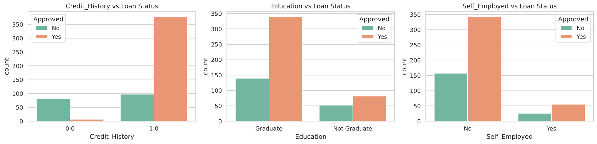
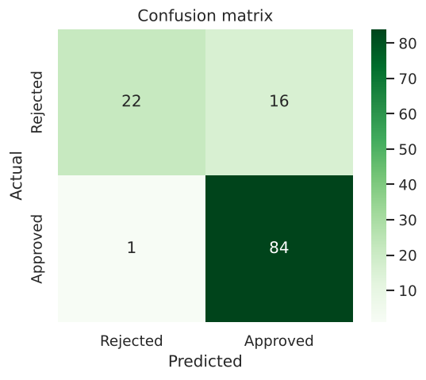

# 🏦 Loan Approval Prediction with SVM

Predicts whether a bank will **approve or reject** a loan application from the applicant's profile, using a Support Vector Machine tuned across linear, RBF and polynomial kernels.



## Results

| Model (test set, 123 applications) | Accuracy | F1 |
|---|---|---|
| Baseline: approve everyone | 69.1% | – |
| SVM, first version (`dropna()` on all rows) | 82.3% | 0.889 |
| **SVM, final (impute missing features)** | **86.2%** | **0.908** |

**Key fix:** the first version dropped every row with *any* missing value. Only the 367 rows without a label actually need removing — rows that are missing a feature like `Credit_History` can be imputed inside the pipeline. Keeping them gave the model more data and **+3.9 points of accuracy**, without changing the algorithm.

## Insights

* **Credit history is by far the strongest factor**: applicants with a good history are approved most of the time, almost none without it are.
* Income and loan amount on their own do **not** separate approved from rejected applications.
* Graduates and salaried (non self-employed) applicants are approved slightly more often.

## Approach

* `ColumnTransformer`: median imputation + scaling for numeric features, most-frequent imputation + one-hot encoding for categorical ones.
* `GridSearchCV` (5-fold, F1) over linear, RBF and polynomial kernels → best: **RBF, C=1, gamma=0.01**.
* Stratified 80/20 split, compared against a "most frequent" baseline.



## Run it

```bash
pip install -r requirements.txt
jupyter notebook loan_approval_svm.ipynb
```

**Tech:** Python · pandas · scikit-learn (SVC, Pipeline, ColumnTransformer, GridSearchCV) · seaborn

---

## 👤 Author

**Reda Akram** — Computer Science (AI) student at the University of Technology, Baghdad. I build ML models, automation systems and AI agents.

GitHub: [@devb777r](https://github.com/devb777r)
